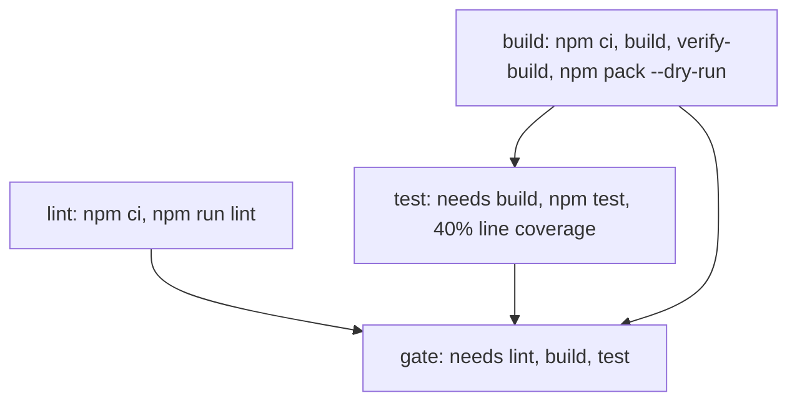
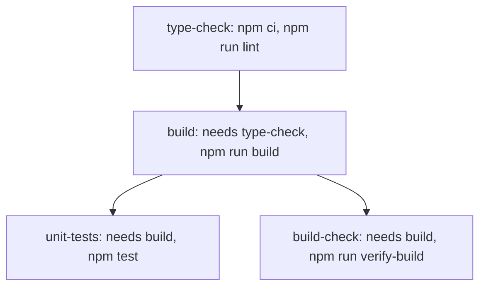
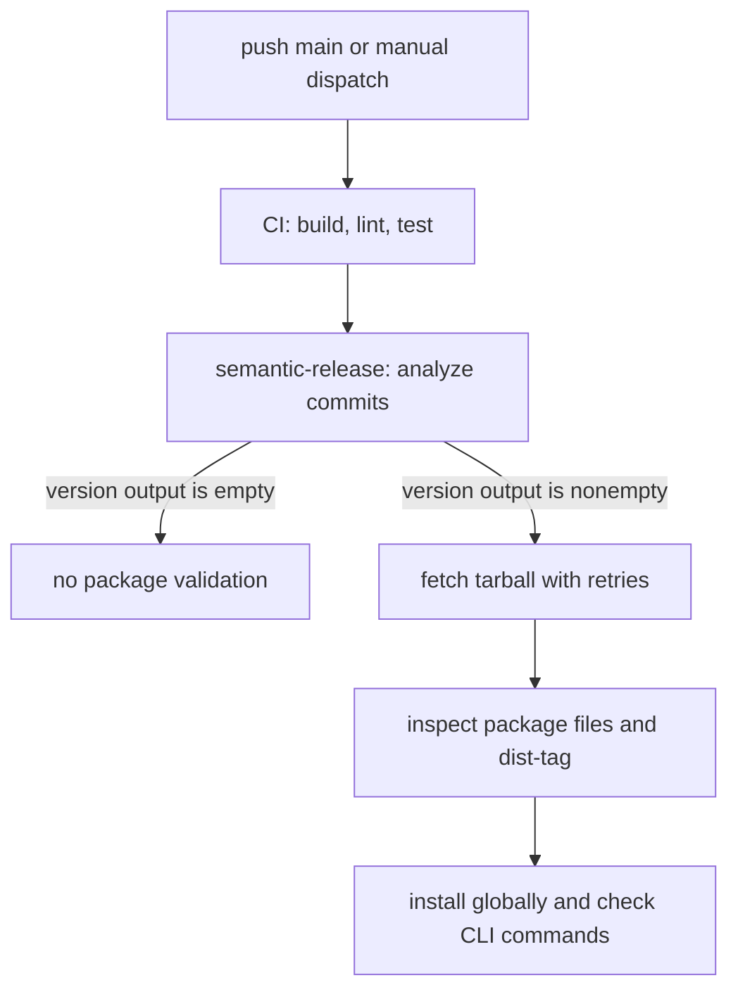

# CI and npm Release Pipeline

This runbook describes the workflows in `.github/workflows/`. CI and publishing
are separate workflows, and the release workflow has its own build and test
job before semantic-release can publish.

## Continuous integration

Both `ci.yml` and `pre-push-tests.yml` run for pushes to `main` and pull
requests targeting `main`.
The main CI workflow also supports manual dispatch.

### Main CI workflow

The lint and build jobs start in parallel. Tests wait for the build artifact;
the final gate waits for lint, build, and tests.

The lint job uses Node 20. Build and test use Node 22. Test runs `npm test` and
enforces at least 40% line coverage with c8. Build also verifies `dist/` and
checks the package contents with `npm pack --dry-run`.

The repository's `main` branch protection currently requires `lint`, `build`,
`test`, and `gate`, with the branch up to date before merging. These are GitHub
repository settings rather than declarations in the workflow YAML; recheck
them when changing merge policy.

### Pre-push workflow

`pre-push-tests.yml` is a GitHub Actions workflow, separate from the optional
local Git pre-push hook. Its type check precedes the build; unit tests and build
verification then run in parallel after the build.

These workflow jobs currently use Node 22. The workflow runs `npm test` for
the test job; its comment calls the tests “fast” but the command does not
select a narrower test subset.

## Automated npm release

`publish.yml` runs on pushes to `main` and through `workflow_dispatch`. Its CI
job must pass build, lint, and tests before the release job starts. The release
job uses Node 22, builds and checks the package, then runs `npm run release`
(semantic-release) with the npm environment credentials.

The semantic-release config analyzes Conventional Commits on `main` and creates
Git tags in the form `v<version>`. Its explicit release rules are:

| Commit signal | Release |
|---|---|
| `feat` | minor |
| `fix` or `perf` | patch |
| Breaking change | major |
| Ordinary `docs` commit without a breaking-change marker | no release |

These are the explicit configured rules. Commits that do not match them are
also evaluated against commit-analyzer's default rules; for example, a
recognized revert can select a patch release.

Therefore a successful workflow run does not necessarily publish anything.
The workflow compares `package.json` version before and after semantic-release;
only when the version changes does it expose a version output for the validate
job. Package version values in a checkout, published npm metadata, or Git tags
can represent different points in the release history; consult npm and the
repository tags for current published state.

The validate job runs only when the release job produced a nonempty version
output. It retries `npm pack --prefer-online codeatlas-mcp-server@<version>`
against fresh registry metadata up to 10 times, waiting 15 seconds between
attempts. It checks the downloaded tarball for required files and for absence
of test files, confirms that npm's `latest` dist-tag points to the released
version, then globally installs the version and checks the `codeatlas`,
`codeatlas-mcp`, and `codeatlas-enterprise` commands.

There is no separate supported manual `npm version` / `npm publish` procedure
in this repository's release pipeline. To publish a change, merge a qualifying
Conventional Commit to `main` and let the workflow select and publish its
version. A manual workflow dispatch runs the same CI and semantic-release
automation; it does not bypass commit analysis.

The release workflow waits for its own CI job. It does not depend on completion
of the separate main CI, pre-push, or CodeQL workflows. Its `release-main`
concurrency group serializes release runs without cancelling an in-progress
release.

## Security automation

GitHub-managed CodeQL, GitHub Advanced Security, and Dependabot Updates
workflows are also active in the repository. Their dynamic workflow definitions
are managed through GitHub rather than checked-in files in
`.github/workflows/`. Inspect the [Actions page](https://github.com/giauphan/codeatlas-mcp-server/actions)
for their current runs and the
[Dependabot](https://github.com/giauphan/codeatlas-mcp-server/security/dependabot)
and [code scanning](https://github.com/giauphan/codeatlas-mcp-server/security/code-scanning)
pages for outstanding alerts. These workflows are separate from the four
required CI checks listed above.

For local dependency checks, run `npm audit` after `npm ci`. Keep both lockfiles
and the [braces compatibility package](./braces-depth-guard.md) consistent when
updating dependencies. Report new vulnerabilities using the
[security policy](../SECURITY.md).

## Manual npm tag rollback

`npm-rollback.yml` only runs when manually dispatched. It checks that the
specified known-good version exists, moves the npm `latest` dist-tag to it, and
can optionally deprecate a specified bad version with a message.

This operation changes npm metadata. It does not revert Git history, delete a
Git tag, or remove a published version. See [Installation and Deployment](./DEPLOYMENT.md#release-rollback).
