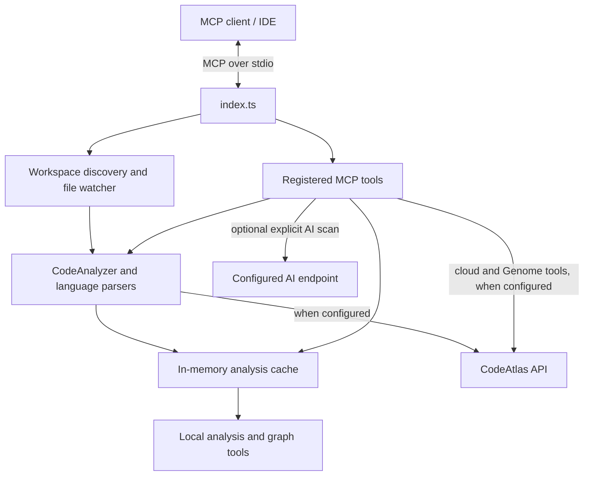

# MCP Server Architecture

CodeAtlas MCP Server is a Node.js MCP process. The current entry point connects with the MCP SDK's standard-I/O transport; it does not start an HTTP or SSE server. The MCP client supplies workspace roots when available. CodeAtlas discovers eligible projects, parses source locally, and exposes analysis and search tools through MCP.

The analysis graph is held in process memory. The server also stores a project-path registry and diagnostics under `~/.codeatlas/`; it does not save the generated analysis graph to `.codeatlas/analysis.json` in this flow. Project discovery can use the workspace, `.codeatlas` project markers, and the local registry. The watcher re-indexes eligible file changes and triggers the same background sync path.

Cloud behavior is conditional on credentials and configuration. Analysis calls and watcher updates attempt to POST analysis results to `CODEATLAS_API_URL`; with no resolved API key, the local analysis remains available in memory and the cloud sync is skipped with an error. Other tools for project memory and Genome call the configured API directly and require an API key. During normal MCP startup, the entry point loads `.env` from the current directory and then `~/.codeatlas/.env` without overriding existing values. The key is read first from `CODEATLAS_API_KEY`, then from recognized local MCP client configuration files. CLI commands are routed before this dotenv loading. The API base URL must use HTTP or HTTPS and be a recognized CodeAtlas, OpenCode, or local host; other hosts require `CODEATLAS_ALLOW_CUSTOM_URL=true`. Non-local HTTP is rejected, so remote endpoints require HTTPS. Cloud sync uses Node's HTTP(S) request clients; Genome and configured AI requests reject redirects.

An optional AI security scan runs only when both `CODEATLAS_SCAN_AI_URL` (or `OPENCODE_BASE_URL`) and its corresponding key are configured. It accepts HTTPS URLs and HTTP only for loopback hosts, rejects redirects, and sends up to five CRITICAL/HIGH finding summaries (including paths and line numbers), not source-file contents. This is a separately configured destination from the CodeAtlas API.

`CODEATLAS_MULTI_TENANT` changes project discovery and `checkAuth` behavior in the service code. The current stdio entry point does not establish a network authentication context or create an HTTP/SSE listener, so those service branches do not by themselves provide a deployed multi-tenant server.

| Area | Current implementation |
|---|---|
| Parsing | Local TypeScript/JavaScript, Python, and PHP analysis through parser modules |
| Graph and search | In-memory project graph exposed by registered MCP tools |
| Watcher | Watches discovered workspace paths and incrementally re-indexes changes |
| Cloud | Optional CodeAtlas API calls, gated by URL configuration and resolved credentials |
| AI scan | Optional configured endpoint; sends a small summary of critical/high findings |
| Persistence | Project paths in `~/.codeatlas/registered_projects.json`, logs in `~/.codeatlas/mcp.log`, plus any client configuration that contains credentials |

Tool names and schemas are registered in [`src/presentation/mcpServer.ts`](../../src/presentation/mcpServer.ts). The canonical CI workflow and its checks are documented in [`PIPELINE.md`](../PIPELINE.md).
